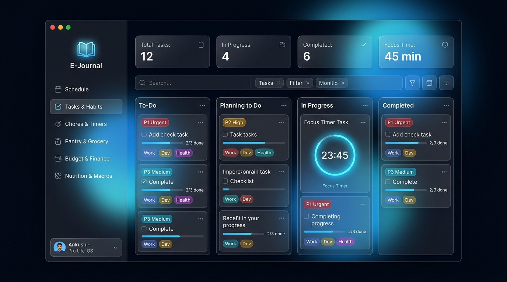

<div align="center">

# E-Journal

**A unified, modular personal operating system for daily logging and lifestyle management.**

[](https://github.com/AnkushKr836/E-Journal)
[](https://flutter.dev)
[](https://riverpod.dev)
[]()
[]()
[](LICENSE)

<br />

> *"Your entire day, unscattered. One unified journal for everything you do, spend, eat, and plan."*

<br />



<br />

[Overview](#overview) &nbsp;&bull;&nbsp;
[Design System](#design-system) &nbsp;&bull;&nbsp;
[Tasks & Kanban Module](#tasks--kanban-engine-module-1) &nbsp;&bull;&nbsp;
[Functional Dimensions](#functional-dimensions) &nbsp;&bull;&nbsp;
[Architecture & Tech Stack](#architecture--tech-stack) &nbsp;&bull;&nbsp;
[Roadmap](#roadmap) &nbsp;&bull;&nbsp;
[Getting Started](#getting-started)

</div>

---

## Overview

Personal life management is currently fragmented across half a dozen single-purpose applications: task lists in one, grocery checklists in another, caloric intake in a third, and financial ledgers elsewhere. This fragmentation induces cognitive friction and subscription fatigue, and prevents meaningful cross-domain insights.

**E-Journal** consolidates day-to-day logging into a cohesive, high-performance platform. Built with **Flutter 3.x** and **Clean Architecture**, it delivers a native cross-platform experience across **Windows Desktop** and **Android**, ensuring you spend less time administering your tools and more time executing your day.

---

## Design System

E-Journal features a bespoke **Frosted Glass (Glassmorphism)** visual identity with vibrant **Icy Blue** accents, calibrated for deep work and high aesthetic clarity:

- **Dual-Mode Theme Architecture:**
  - 🌌 **Dark Theme:** Deep Cosmic Black (`#050811`) and Midnight Blue (`#0A1124`) paired with electric Sky Blue glow (`#38BDF8`).
  - ❄️ **Light Theme:** Crisp Icy Slate (`#F1F5F9`) and pure Icy White (`#FFFFFF`) with subtle translucent mist borders.
- **Translucent Refraction (`GlassContainer`):** Custom GPU-accelerated backdrop blur (`ImageFilter.blur`), specular gradient borders, and ambient colored orbs positioned behind glass surfaces.
- **Responsive Layout:** Adaptive sidebar for desktop screens ($\ge 900\text{px}$) and a sleek bottom glass navigation bar for mobile form factors.

---

## Tasks & Kanban Engine (Module 1)

The **Tasks & Habits Module** is engineered with rich capabilities inspired by industry-leading task tools (Linear, TickTick, Things 3):

```
┌────────────────────────────────────────────────────────────────────────┐
│                        Tasks Screen Architecture                       │
├────────────────────────────────────────────────────────────────────────┤
│  Top Metrics Ribbon: [Total: 12] [In Progress: 4] [Completed: 6] [45m] │
│  Control Bar: [Keyword Search] [Priority Filter] [Tag Chips] [Kanban]  │
├───────────────┬───────────────────┬────────────────┬───────────────────┤
│    TO-DO      │  PLANNING TO DO   │  IN PROGRESS   │     COMPLETED     │
│  (Backlog)    │   (Queued/Sprint) │  (Active Task) │  (Archived/Done)  │
│               │                   │  [Focus Timer] │                   │
│  - Nested     │  - Nested         │  - Active      │  - Rollover logic │
│    Subtasks   │    Subtasks       │    Ticker      │    for Recurring  │
│  - Tag & P1-P4│  - Tag & P1-P4    │  - P1-P4 Tags  │  - Checkmark glow │
└───────────────┴───────────────────┴────────────────┴───────────────────┘
```

### Key Capabilities:
- 📋 **4-Stage Kanban Workflow:** Drag-and-drop tasks seamlessly across `To-Do` $\rightarrow$ `Planning to Do` $\rightarrow$ `In Progress` $\rightarrow$ `Completed`, or use one-click status stepper buttons on cards.
- ⏱️ **Integrated Focus / Pomodoro Timers:** Embedded duration countdowns with preset selectors (15m, 25m, 45m, 60m, 90m), live ticking timers, glowing Icy Blue indicator rings, and cumulative daily focus tracking.
- 🎯 **Eisenhower Priority Matrix:** Strict visual tiering across `P1 Urgent` (Crimson), `P2 High` (Amber), `P3 Medium` (Sky Blue), and `P4 Low` (Muted Slate).
- 🧩 **Nested Subtasks & Progress Bars:** Expandable checklist items within task cards with real-time percentage completion calculation (`x/y completed`).
- 🔁 **Intelligent Recurrence Engine:** Supports Daily, Weekly (multi-day selection, e.g. Mon/Wed/Fri), Monthly, and Custom interval ($N$-day) rollover rules. Marking a recurring task complete archives the current entry and schedules the next cycle automatically.
- 🔍 **Real-Time Filtering & Search:** Instant keyword lookup across titles and notes, priority dropdown filters, and multi-tag filtering chips (`Work`, `Personal`, `Dev`, `Health`, etc.).
- 🔀 **Dual View Modes:** Effortlessly toggle between a full **Kanban Board** and a **Compact List** view.

---

## Functional Dimensions

E-Journal models daily life through eight interconnected modules:

| Dimension | Status | Key Capabilities |
| :--- | :---: | :--- |
| **Tasks & Habits** | 🟢 **Live** | 4-column Kanban board, Pomodoro timers, P1–P4 priorities, nested subtasks, smart recurrence rollover, keyword search & tag filters. |
| **Domestic Maintenance** | 🟡 *In Progress* | Living space upkeep, appliance servicing intervals (*"Wash linens every 10 days"*), audible laundry & cooking cycle timers, room categorization. |
| **Provisioning & Pantry** | ⚪ *Planned* | Categorized grocery checklists (Produce, Dairy, Essentials), frequently purchased staples, real-time basket cost estimation. |
| **Capital & Finance** | ⚪ *Planned* | Categorical income and expenditure logging, monthly expenditure limits, recurring billing reminders, visual cashflow breakdown. |
| **Nutrition & Fuel** | ⚪ *Planned* | Daily caloric and macronutrient targets (P/C/F), hydration glass tracker, rapid custom meal presets. |
| **Expeditions & Travel** | ⚪ *Planned* | Chronological day-by-day travel plans, linked trip expenditure sub-ledger, packing and logistics checklists. |
| **Academic & Focus** | ⚪ *Planned* | Modular curriculum tracking, spaced revision scheduling, integrated Pomodoro sessions with automated time allocation. |
| **Milestones & Events** | ⚪ *Planned* | Critical dates, appointment tracking, countdown timelines for upcoming milestones. |

---

## Architecture & Tech Stack

```
                              ┌──────────────────────────────┐
                              │       E-Journal Client       │
                              ├──────────────┬───────────────┤
                              │ Android App  │  Windows PC   │
                              └──────┬───────┴───────┬───────┘
                                     │               │
                             ┌───────▼───────────────▼───────┐
                             │       Presentation Layer      │
                             │   (Riverpod 3.x + Glass UI)   │
                             └───────────────┬───────────────┘
                                             │
                             ┌───────────────▼───────────────┐
                             │      Domain & Models Layer    │
                             │  (TaskItem, RecurrenceRule)   │
                             └───────────────┬───────────────┘
                                             │
                             ┌───────────────▼───────────────┐
                             │   Local-First Storage Engine  │
                             │    (SQLite / Embedded DB)     │
                             └───────────────────────────────┘
```

| Layer | Technology | Purpose |
| :--- | :--- | :--- |
| **UI Framework** | **Flutter 3.x (Dart 3.x)** | Compiles natively to high-performance Windows C++ Desktop and Android binaries. |
| **State Management** | **Flutter Riverpod 3.x** | Compile-safe, reactive state and dependency injection using `Notifier` providers. |
| **Design Language** | **Frosted Glassmorphism** | GPU-accelerated backdrop blur, specular borders, and dual-mode color schemes. |
| **Local Data Engine** | **Drift (SQLite) / Isar** | Zero-latency local reads/writes, offline-first reliability. |
| **Cloud Sync & Auth** | **Supabase** | Cloud PostgreSQL, Row Level Security, and multi-device identity sync. |

---

## Roadmap

### Phase 1 &mdash; Core Platform & MVP *(Active)*
- [x] Architecture design, domain modeling, and technical PRD specification.
- [x] Cross-platform Flutter desktop client with Frosted Glass UI.
- [x] Dark and Light theme engine with Icy Blue accents.
- [x] **Module 1 (Tasks & Habits):** 4-column Kanban board with drag-and-drop.
- [x] **Module 1 (Tasks & Habits):** Integrated focus timers with live ticking.
- [x] **Module 1 (Tasks & Habits):** Eisenhower priority matrix (P1–P4) & tag filtering.
- [x] **Module 1 (Tasks & Habits):** Nested subtask checklists with progress tracking.
- [x] **Module 1 (Tasks & Habits):** Recurring task engine with automatic rollover.
- [ ] **Module 2 (Domestic Maintenance):** Room checklists & exact cycle alarms.
- [ ] **Module 3 (Provisioning & Pantry):** Smart grocery checklists & basket cost calculator.
- [ ] Local storage persistence layer (Drift SQLite).

### Phase 2 &mdash; Financial Ledger & Dietary Tracking
- [ ] **Module 4 (Capital & Finance):** Budget caps, expense categories, recurring bills.
- [ ] **Module 5 (Nutrition & Fuel):** Caloric goals, macronutrient splits, water logger.
- [ ] Automated Morning Agenda & Evening Reflection engine.
- [ ] Cloud synchronization and multi-device auth via Supabase.

### Phase 3 &mdash; Extended Life Modules & Platform Maturity
- [ ] **Module 6 (Expeditions & Travel):** Multi-day itineraries & trip expenses.
- [ ] **Module 7 (Academic & Focus):** Study syllabus & spaced repetition.
- [ ] Android home screen quick-capture widgets.
- [ ] Biometric app lock (Fingerprint / Face Unlock).
- [ ] JSON / CSV data export and offline local backups.

---

## Project Structure

```text
E_Journal/
├── lib/
│   ├── core/
│   │   ├── theme/           # AppTheme, theme_provider (Dark/Light frosted glass)
│   │   └── widgets/         # GlassContainer (BackdropFilter blur & borders)
│   ├── features/
│   │   ├── dashboard/       # DashboardScreen (Sidebar, Header, Overview panels)
│   │   └── tasks/           # Tasks Module
│   │       ├── domain/models/       # TaskItem, TaskStatus, TaskPriority, RecurrenceRule, SubTask
│   │       └── presentation/        # TasksScreen, TasksNotifier, TaskCard, KanbanColumn, TaskFormDialog
│   └── main.dart            # Application entry point & Riverpod Scope
├── test/
│   ├── features/tasks/      # Domain & integration tests for Tasks module
│   └── widget_test.dart     # Smoke tests
├── windows/                 # Windows C++ desktop runner
├── android/                 # Android native runner
├── docs/screenshots/       # High-resolution screenshots & UI previews
├── PRD.md                   # Product Requirements Document v1.0
└── pubspec.yaml             # Dependencies and Flutter configuration
```

---

## Getting Started

### Prerequisites
- [Flutter SDK](https://docs.flutter.dev/get-started/install) ($\ge 3.24$)
- [Dart SDK](https://dart.dev/get-dart) ($\ge 3.5$)
- **Windows Desktop:** Visual Studio 2022 with *Desktop development with C++*
- **Android:** Android Studio with Android SDK 34+

### Installation & Run

1. **Clone the repository:**
   ```bash
   git clone https://github.com/AnkushKr836/E-Journal.git
   cd E-Journal/e_journal
   ```

2. **Install dependencies:**
   ```bash
   flutter pub get
   ```

3. **Run the test suite:**
   ```bash
   flutter test
   ```

4. **Launch on Windows Desktop:**
   ```bash
   flutter run -d windows
   ```

5. **Launch on Android:**
   ```bash
   flutter run -d android
   ```

---

## License

Distributed under the terms of the [MIT License](LICENSE).
